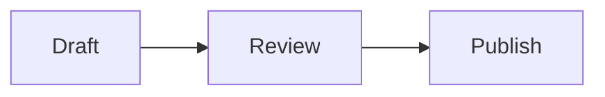

Mermaid and KaTeX can be connected as optional Markdown integrations using standard VitePress approaches.

## Mermaid

Install the renderer and Mermaid itself in your blog:

```bash
pnpm add -D vitepress-plugin-mermaid mermaid
```

In `.vitepress/config.ts`, wrap the built Neptu config:

```ts
import { withMermaid } from 'vitepress-plugin-mermaid'
import { defineBlogConfig } from 'vitepress-theme-neptu/configs'

export default async () => {
  const config = {
    // existing Neptu config
  }

  return withMermaid(await defineBlogConfig(config))
}
```

Then use a standard fenced code block:

````md

````

`withMermaid` must remain the outer wrapper so it can register its own VitePress hooks. Options and version compatibility are documented in the [plugin repository](https://github.com/emersonbottero/vitepress-plugin-mermaid).

Mermaid settings — theme, diagram direction, and other options — are passed via the `mermaid` property inside the config:

```ts
return withMermaid({
  ...await defineBlogConfig(config),
  mermaid: {
    // MermaidConfig — see https://mermaid.js.org/config/setup/modules/mermaidAPI.html
  },
})
```

Mermaid renders entirely on the client: during SSR and in static HTML output, diagrams are empty placeholders that render after client-side hydration. This is expected behavior and requires no extra setup.

## KaTeX

Install the markdown-it plugin (KaTeX is installed automatically as a dependency):

```bash
pnpm add -D @mdit/plugin-katex
```

Register it via VitePress's existing markdown hook:

```ts
import { katex } from '@mdit/plugin-katex'

const config = {
  markdown: {
    config(md) {
      md.use(katex)
    },
  },
  // rest of Neptu configuration
}
```

Import the styles once in `.vitepress/theme/index.ts`:

```ts
import 'katex/dist/katex.min.css'
```

The plugin accepts configuration options — for example, to prevent build failures on syntax errors:

```ts
md.use(katex, { throwOnError: false })
```

Inline and block formulas use `$` and `$$` delimiters:

```md
Euler's formula: $e^{i\pi}+1=0$.

$$
x = {-b \pm \sqrt{b^2-4ac} \over 2a}
$$
```

The full-text feed intentionally processes safe standard Markdown and does not execute arbitrary VitePress plugins or Vue components. Without a custom feed transformer, diagrams and formulas will appear in feeds as raw source text.

## Troubleshooting

- **Formulas render as raw text** — verify that KaTeX CSS is imported in `theme/index.ts` and the plugin is registered in `markdown.config`.
- **`$` conflicts with currency** — escape dollar signs in prose using a backslash: `\$`. Alternatively, configure custom delimiters in plugin options.
- **Diagram does not appear** — Mermaid renders exclusively in the browser. Open your browser's DevTools console: diagram syntax errors will be printed there.

This KaTeX guide is based on the [`@mdit/plugin-katex` documentation](https://mdit-plugins.github.io/katex.html).
If KaTeX is not strictly required, VitePress also documents built-in optional [MathJax support](https://vitepress.dev/guide/markdown#math-equations).

---

Next: [External content — CMS, API and custom data loaders](external-content)
